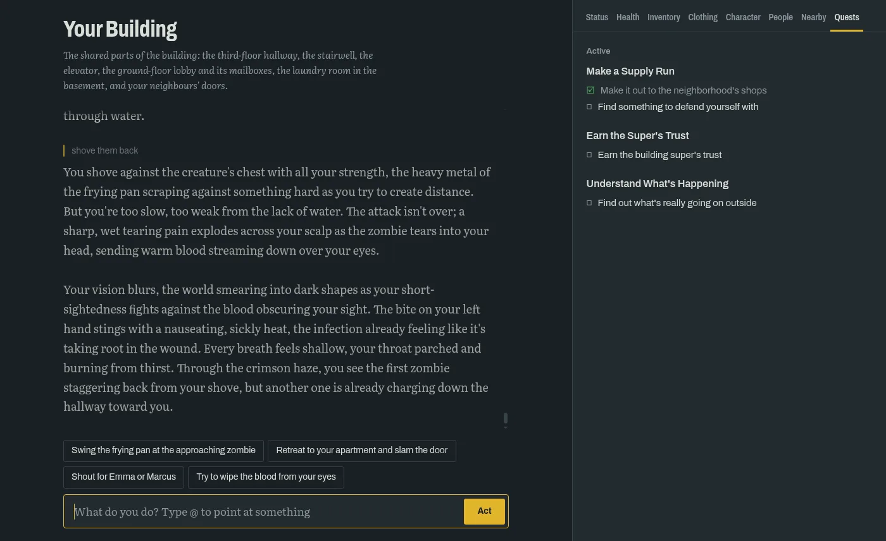
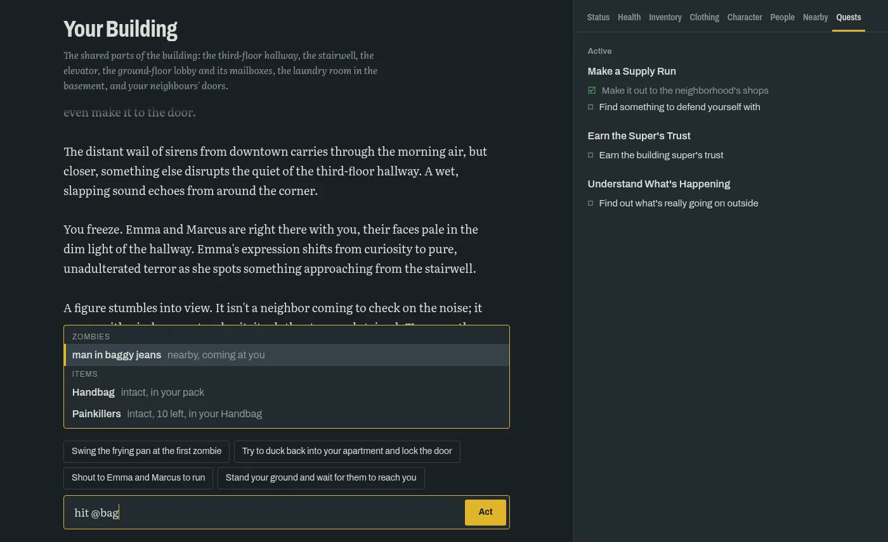
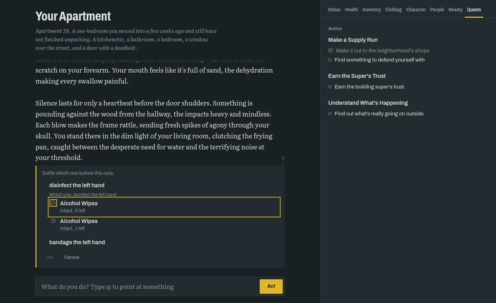
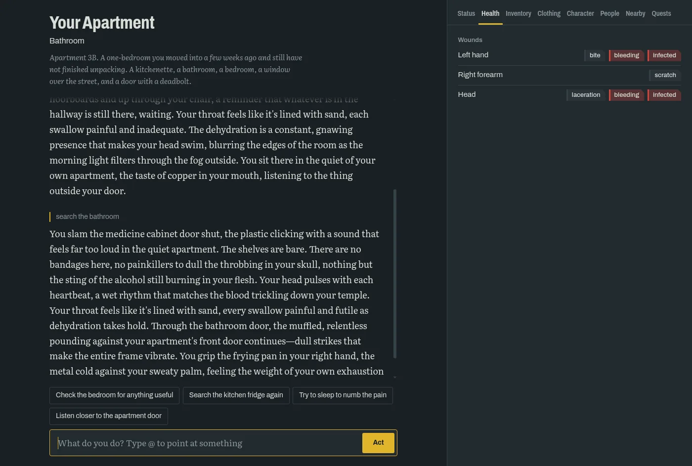

# Over the River

A narrative-driven text RPG set in the first days of a zombie outbreak,
played in your browser and run by a language model on your own machine.

You type what your character does, in plain words. The game works out what
actually happens: whether the door holds, whether the swing lands, how
thirsty you are by nightfall. Then the model tells it as a story. The model
never decides the outcome, so it can't hand you an item you don't have or
let you survive a bite it made up.



## The game

It's early October in Calder, a grey river city. You've lived in Ashby, a
working neighbourhood on the east bank, for a few weeks. The news is full of
a fever at St. Agnes hospital, the mayor calls it a bad flu season, and the
corner store has already been stripped bare. The game starts at 08:00 on a
Sunday in your apartment.

What you can do:

- **Survive.** Hunger, thirst, tiredness, boredom and body temperature move
  with the clock. Rain soaks you, cold makes you sick, and every action takes
  game time.
- **Scavenge.** Search rooms, cupboards and bodies. Carry what fits in your
  hands and bags.
- **Fight, or don't.** Swing what you hold, shove, sneak past, or lock and barricade a door.
  Zombies hear noise and follow you, and a door can be broken down or
  barricaded.
- **Get hurt.** Wounds land on body parts. They bleed and can get infected,
  and a bite may be the end of you. Bandage and disinfect what you can.
- **Talk.** Your neighbours remember how you treat them and know things
  about what's going on. Ask them the right questions.
- **Find out.** The city has a story behind the outbreak. The narrator only
  tells you what your character has seen or been told.

There are eleven places to explore, from your apartment and building out to
the street, the shops, a clinic and a supermarket.

### How to play

- **Create a character** on the first screen: pick a preset or build your
  own from an occupation, traits and looks. Traits cost points; their
  effects are real.
- **Type what you do**, as you'd say it: `search the kitchen`,
  `take the knife and go downstairs`, `ask Emma about her brother`. Several
  steps in one line are fine; at most five happen per turn.
- **Pick a suggestion** under the story to play it, or ignore them.
- **Type `@`** to list what's in reach (people, items, doors, zombies, bodies,
  places) and pick exactly the one you mean. The pick shows as a chip in your
  text.
- **Answer the plan screen.** When "the bag" could mean two bags, the game
  shows your plan step by step and asks which one, before anything happens.
- **Check the tabs** beside the story (Status, Health, Inventory,
  Clothing, Character, People, Nearby, Quests). The story is told in words;
  the tabs show where you stand.
- **Saves** are automatic after every turn. The Menu can save to a file,
  load from one, or reset the game.

| Pointing at something with `@` | Settling which one you mean | Wounds by body part |
| --- | --- | --- |
|  |  |  |

When the game can't do something you asked, it tells you so in the story
instead of pretending, and the refused part costs no time.

## Running it

You need:

- **Python 3.13** or newer;
- **[LM Studio](https://lmstudio.ai/)** with a chat model loaded and its
  server running (port 1234, OpenAI-compatible API). The game is developed
  against a Gemma 4 26B-A4B model with a 16k context; any model LM Studio
  serves can work, but smaller ones follow the game's rules less well;
- an internet connection on first start, to download the small embedding
  model the game uses to recall past events. It runs on the CPU.

### Quick start

The project uses [mise](https://mise.jdx.dev/), which installs the right
Python and uv and manages the virtual environment:

```bash
mise trust
mise install
mise run install    # dependencies into .venv
mise run dev        # starts the game
```

Then open <http://localhost:5000>.

On Linux, `sentence-transformers` pulls in the multi-GB CUDA build of
PyTorch by default. The game doesn't need it; install the CPU build first:

```bash
uv pip install torch --index-url https://download.pytorch.org/whl/cpu
mise run install
```

<details>
<summary>Without mise</summary>

Linux / macOS:

```bash
python3.13 -m venv .venv
source .venv/bin/activate
python -m pip install -r requirements.txt
python app.py
```

Windows:

```powershell
py -3.13 -m venv .venv
.venv\Scripts\Activate.ps1
python -m pip install -r requirements.txt
python app.py
```

</details>

### Configuration

Settings live in `config.yml`, each with a comment. The ones you're most
likely to change:

| Setting | What it does |
| --- | --- |
| `llm.base_url` | LM Studio's address. To use LM Studio on another machine, point this at it and turn on *Serve on Local Network* in LM Studio. |
| `llm.model_name` | The narrator's model key in LM Studio. Needed once more than one model is loaded. |
| `llm.parser_model_name` | A separate model for reading your input. Empty means the narrator's model does it. |
| `llm.narrator_sampler` | Sampler settings (temperature, top_k, top_p, min_p, repeat_penalty). Use what your model's card recommends. |
| `llm.narrator_reasoning_effort` | Thinking for models that can think: none, low, medium, high. Raise `narrator_max_tokens` with it. |
| `llm.context_tokens` | Your model's context window; the narrator's prompt is cut to fit. |
| `factcheck.model_name` | The model that checks the story against the game's state. A small model loaded beside the narrator, or the narrator's own when the GPU has no room. |
| `factcheck.enabled` | `false` skips the checks, for speed or a model that can't answer them. |

If the fact-check model isn't loaded, the game logs a warning and plays on
without the check. With several models, load the narrator and the fact-check
model before the first turn: LM Studio loads the parser's model on demand,
and whatever loads last gets the least GPU.

## Under the hood

### How a turn works

The model proposes, the engine decides, the model describes:

```
your input
  -> parser (LLM)       what are you trying to do? a typed action plan, no prose
  -> plan check (LLM)   drop actions you didn't ask for
  -> validator          is each action possible? no state changes
  -> simulation         decide every outcome and change the state
  -> narrator (LLM)     tell what happened, from the engine's facts
  -> fact check (LLM)   does the story contradict the state? one retry
  -> save
```

The parser's reply is constrained by a JSON schema built from the current
scene, so it can only name things that exist. The facts handed to the
narrator are words, never numbers. A request the engine refuses reaches the
narrator as a refusal in the same turn. When a plan moves you to another
zone, the rest of your input is parsed again there. The full design is in
[docs/architecture/engine-authority.md](docs/architecture/engine-authority.md)
and [docs/architecture/turn-loop.md](docs/architecture/turn-loop.md).

### Layout

The code is layered; a layer imports only from the layers above it in this
list, and `mise run lint` enforces it:

```
modules/    the pure game model: entities, items, the typed action plan
data/       static content and tuning numbers: items, map, NPCs, traits, loot
managers/   game logic: validator, simulation, prompt building, each domain
adapters/   the outside world: LM Studio, embeddings, saves, the turn itself
app.py      HTTP only
static/, templates/   the browser UI
```

Inside each layer, files group by domain: `world`, `zombies`, `corpses`,
`loot`, `body`, `clothing`, `character`, `combat`, `story`, `events`.

### Where to read

| Folder | What's in it |
| --- | --- |
| [docs/mechanics/](docs/mechanics/) | The game's rules as built, one per mechanic, with their numbers. The code cites them by id (`# melee`). |
| [docs/architecture/](docs/architecture/) | How the running system is built: the turn loop, the LLM's roles, memory, saves, the UI. |
| [docs/design/](docs/design/) | Intent that isn't built yet. A target, not a description. |
| [docs/lore/](docs/lore/) | The world's story, secrets included. The narrator reads only the short lorebook entries drawn from it. |
| [docs/status.md](docs/status.md) | Which docs are real code, and what doesn't exist yet. |
| [AGENTS.md](AGENTS.md) | Code conventions: randomness, time, constants, comments, imports, tests. |

### Commands

```bash
mise run dev          # run the game
mise run test         # the test suite, one module per core
mise run test-serial  # the same, in one process
mise run fmt          # ruff format + autofix
mise run lint         # ruff, format check, layer contracts
mise run typecheck    # basedpyright against the baseline
mise run check        # all of the above; run before calling work done
```

The suite is offline and fast. The LLM and the embedding model are stubbed,
`config.yml` is ignored, and the world seed is fixed. `tests/test_memory.py`
runs the real embedding model only when `RPG_TEST_EMBEDDINGS=1` is set; the
first run downloads it.

Model quality is measured separately, by hand, against LM Studio:
`python scripts/eval_parser.py` runs the parser cases in
`evals/parser_cases.yaml`.

### Saves

The game saves `gamedata/engine_state.json` after every turn, atomically.
Only dynamic state is saved. Static content stays in `data/` and is looked
up by id, so content can be rebalanced without breaking saves. A change to
saved state bumps `SCHEMA_VERSION` in `adapters/save/codec.py`; a save from
another version is discarded and a new game starts.

### HTTP routes

| Route | Method | Purpose |
| --- | --- | --- |
| `/` | GET | The game |
| `/state` | GET | The current state, so a reloaded page shows the real world |
| `/creation` | GET, POST | The character creation options; start a game with a build |
| `/play` | POST | `{"input": "..."}` runs a turn |
| `/play/stream` | POST | The same turn as JSON lines: each step, the narrator's thinking and story as written, then the turn |
| `/plan/go/stream` | POST | Run a plan waiting on the plan screen, with the player's answers |
| `/plan/cancel` | POST | Drop that plan |
| `/save/export` | GET | Download the save |
| `/save/import` | POST | Load a save file |
| `/reset` | POST | Delete the save and start over |
